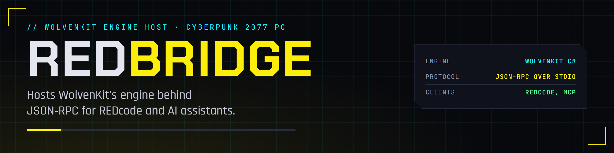
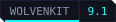
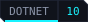
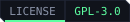

<p align="center">
  
</p>

<p align="center">
  <a href="https://edgemodders.github.io/REDbridge/"></a>
  
  
  
  <a href="LICENSE"></a>
</p>

The engine host for [REDcode](https://github.com/Edgemodders/REDcode), a Cyberpunk 2077 modding IDE built on VS Code.

REDbridge runs [WolvenKit](https://github.com/WolvenKit/WolvenKit)'s headless C# libraries in a local process and exposes them over JSON-RPC: archive browsing, CR2W files as JSON and back, texture, mesh and audio conversion, TweakDB queries, import, export and packing. REDcode's extensions are its first client. AI assistants reach the same methods through REDcode's MCP server, `redcode-mcp`, which starts the bridge and talks to it over stdio as the extension does.

**[Read the docs](https://edgemodders.github.io/REDbridge/)** &middot; [REDcode](https://github.com/Edgemodders/REDcode) &middot; [REDnode](https://github.com/Edgemodders/REDnode)

> [!NOTE]
> **Status: C1 bridge MVP works.** The bridge indexes a game install, lists and searches archives, converts CR2W files to JSON and back byte for byte, decodes textures to PNG and resolves hashes, all over JSON-RPC on stdio. `tools/probe.py` exercises it against a real install in about seven seconds. Next: the REDcode extension that talks to it.

## How it works

```
 VS Code (REDcode extensions)      REDbridge (.NET 10)                 WolvenKit libraries
 ┌───────────────────────────┐     ┌────────────────────────────┐     ┌────────────────────┐
 │ archive browser           │     │ JSON-RPC 2.0 over stdio    │     │ RED4: CR2W, archives│
 │ CR2W editor               │◄───►│ method groups: archive,    │◄───►│ Common: JSON, DDS   │
 │ import / export / pack    │     │ cr2w, convert, modkit,     │     │ Modkit: glTF, pack  │
 │ AI assistants via MCP     │     │ tweakdb, sound, hash       │     │ Core: Oodle, hashes │
 └───────────────────────────┘     └────────────────────────────┘     └────────────────────┘
                                    big outputs (PNG, glTF, WAV) go to a cache folder; RPC returns paths
```

| Method group | Examples | Backed by |
|---|---|---|
| `archive` | archives, list, search, tree, extract, extractMany, openMod and extractFromMod (a mod's .archive anywhere on disk, no game needed) | WolvenKit.RED4 |
| `cr2w` | toJson, fromJson, fileToJson; document sessions: open, getNode, getNodes, search, patch, save, close, documents, describeType, createInstance | WolvenKit.RED4, WolvenKit.Common |
| `convert` | texture.toPng, texture.fileToPng, texture.imageToPng (a plain TGA, DDS, TIFF, BMP, JPG or PNG to PNG, for viewing), mesh.toGltf, audio.toWav | WolvenKit.Common, WolvenKit.Modkit |
| `mesh` | info, infoMany: a mesh's or an entity template's bounds and appearance names, for an asset index | WolvenKit.RED4 |
| `sector` | build: an EDGEbuilder scene into a streaming sector, a streaming block and an ArchiveXL file in a REDcode project | WolvenKit.RED4 |
| `project` | pack (a folder into `<modName>.archive` through WolvenKit's packer, with warnings for paths with capital letters or spaces); export (a file under `source/archive` to the same path under `source/raw`: glTF, an image, WAV and so on) and import (back again, an existing texture keeping all its settings), each listing the files written | WolvenKit.Modkit |
| `modkit` | build | WolvenKit.Modkit |
| `tweakdb` | records, record, flats, query | WolvenKit.RED4 |
| `sound` | events: the sound event names WolvenKit knows, with their Wwise hashes, which name the event groups in `sfx_container.opusinfo` | WolvenKit.Modkit's `soundEvents.json` |
| `hash` | fnv1a64, resolve | WolvenKit.Core |
| `script` | not planned: REDcode dropped its script runner | |

## Repository layout

| Path | Contents |
|---|---|
| `docs/` | Documentation site |
| `tools/brand/` | Generates the banner, badges and icon |
| `src/REDbridge/` | The bridge: host, RPC surface, stderr logger |
| `tools/probe.py` | Stdlib Python client that runs every method over the real protocol |
| `external/WolvenKit/` | WolvenKit as a git submodule, pinned to 9.1.0 |

## Build

```powershell
git clone --recurse-submodules https://github.com/Edgemodders/REDbridge.git
cd REDbridge
npm run build:full                              # restore, then build
npm run probe -- "<Cyberpunk 2077 folder>"      # exercise every method against a game install
```

Later, `npm run update` pulls, updates the submodule and rebuilds, and `npm run build` rebuilds after local changes. The scripts only wrap `dotnet` and `git`; `package.json` shows the exact commands. Needs the .NET 10 SDK, Node and Python 3. Details, including the per-user SDK route without administrator rights, are in the [setup guide](https://edgemodders.github.io/REDbridge/dev-setup.html).

## Roadmap

- **C0 Decide.** Build WolvenKit's headless libraries locally and confirm what the bridge references. Agree the approach with the WolvenKit team.
- **C1 Bridge MVP.** `archive.list`, `cr2w.toJson`, `cr2w.fromJson`, `texture.toPng`, `hash.*` over stdio. Proves the data path with REDcode.
- **C2 to C4.** Method groups for browsing, editing, import, export and packing, as REDcode's extensions need them.
- **C5.** Methods for REDcode's viewers: audio (`sound.events`, 0.7.2), then TweakDB. No script host: REDcode dropped its script runner (agents and MCP tools cover it). The MCP server lives in REDcode as [`redcode-mcp`](https://github.com/Edgemodders/REDcode/tree/main/packages/redcode-mcp), MIT, over stdio.

Phases follow the REDcode roadmap.

## Compatibility goals

REDbridge pins a WolvenKit version and tracks its releases. Changes that make WolvenKit's libraries easier to host are sent upstream. Windows only for now, because WolvenKit's texture tooling is.

## Legal

REDbridge links WolvenKit's libraries, which are GPL-3.0, so REDbridge is GPL-3.0. REDcode's extensions talk to it only over stdio and keep their own license. This repository contains no game files and no data extracted from them. Single-player modding only.

## License

[GPL-3.0](LICENSE)
